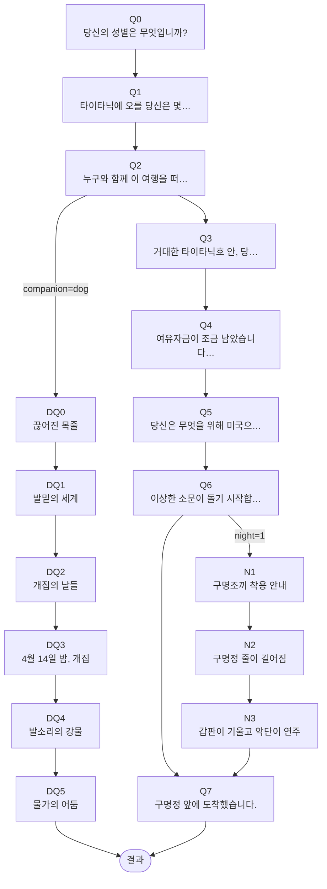

# 분기 지도 (자동 생성)

생성: 2026-11-06 · 명령: `node tools/branch_map.cjs` · **이 파일을 직접 고치지 마세요.** 코드를 바꾼 뒤 다시 생성합니다.

선택지를 하나씩 바꿔 가며 실제로 무엇이 달라지는지 시험한 결과입니다. 한 번에 하나의 선택만 바꿔 보므로, 두 선택이 함께일 때만 달라지는 규칙은 잡히지 않습니다.

## 요약

- 장면 17개 (밤 장면 전용 3개)
- 앞 선택에 따라 **내용이나 다음 장면이 달라지는 장면** 10개: Q2, DQ2, DQ3, DQ4, DQ5, Q6, N1, N2, N3, Q7
- **뒤 내용에 영향을 주지 않는 선택(성향 점수와 결과 카드에만 쓰임)**: `sex`, `ageGroup`, `dogLeash`, `dogFinal`, `pclass`, `fareIntent`, `purpose`, `rumorAction`, `finalAction`

## 장면별 표

| 장면 | 챕터 | 화면 | 질문 | 선택지(값) | 성향 점수 | 기본 다음 장면 | 다음 장면이 달라지는 조건 | 내용이 달라지는 조건 |
|---|---|---|---|---|---|---|---|---|
| Q0 | 탑승 | gender | 당신의 성별은 무엇입니까? | male, female |  | Q1 |  |  |
| Q1 | 탑승 | age | 타이타닉에 오를 당신은 몇 살인가요? | 0-9, 10-17, 18-29, 30-39, 40-49, 50-59, 60+ |  | Q2 |  |  |
| Q2 | 탑승 | companion | 누구와 함께 이 여행을 떠났나요? | alone, partner, friends, family |  | Q3 | companion=dog → DQ0 |  |
| DQ0 | 탑승 | dogintro | 끊어진 목줄 |  |  | DQ1 |  |  |
| DQ1 | 탑승 | dog | 발밑의 세계 | trust, bite, struggle |  | DQ2 |  |  |
| DQ2 | 항해 | dog | 개집의 날들 | befriend, share, ignore |  | DQ3 |  | dogScent=trust → 부제 dogScent=bite → 부제 |
| DQ3 | 그날 밤 | dog | 4월 14일 밤, 개집 | bark, scratch, wait |  | DQ4 |  | dogKennel=befriend → 부제 dogKennel=share → 부제 |
| DQ4 | 그날 밤 | dog | 발소리의 강물 | scent, tom, captain |  | DQ5 |  | dogScent=trust → 선택지 빠짐(captain) dogScent=bite → 선택지 빠짐(captain) dogKennel=befriend → 선택지 빠짐(tom) dogKennel=share → 선택지 빠짐(tom) dogNight=bark → 부제, 선택지 빠짐(captain) dogNight=scratch → 부제 |
| DQ5 | 그날 밤 | dog | 물가의 어둠 | leap, call, accept, return, turn, abandon |  | RESULT |  | dogDeck=tom → 부제, 선택지 빠짐(leap, call, turn, abandon) dogDeck=captain → 부제, 선택지 빠짐(leap, call, accept, return) |
| Q3 | 탑승 | staircase | 거대한 타이타닉호 안, 당신이 가장 끌리는 분위기는… | 1, 2, 3 |  | Q4 |  |  |
| Q4 | 항해 | money | 여유자금이 조금 남았습니다. | luxury, balance, save |  | Q5 |  |  |
| Q5 | 항해 | deck | 당신은 무엇을 위해 미국으로 가나요? | experience, stability, change | ✔ | Q6 |  |  |
| Q6 | 그날 밤 | rumor | 이상한 소문이 돌기 시작합니다. | calm_others, check_crew, check_escape, follow_crowd | ✔ | Q7 | night=1 (밤 장면 경로) → N1 |  |
| N1 🌙 | 그날 밤 | night | 구명조끼 착용 안내 | wake, vest, wait, bag | ✔ | N2 |  | run=2 (두 번째 항해) → 선택지 추가(crew) / 이야기 문장 |
| N2 🌙 | 그날 밤 | night | 구명정 줄이 길어짐 | organize, rule, weak, seat | ✔ | N3 |  | flag:neighbor → 선택지 추가(child) / 이야기 문장 flag:vest → 이야기 문장 flag:waited → 이야기 문장 flag:bag → 선택지 추가(drop) / 이야기 문장 flag:crewTip → 선택지 추가(boat) / 이야기 문장 |
| N3 🌙 | 그날 밤 | night | 갑판이 기울고 악단이 연주 | hold, jump, high | ✔ | Q7 |  | flag:neighbor → 이야기 문장 flag:led → 선택지 추가(leadup) / 이야기 문장 flag:boat → 선택지 추가(row, back, quiet) / 이야기 문장 |
| Q7 | 그날 밤 | cinematic | 구명정 앞에 도착했습니다. | yield_seat, yield_weak, secure_mine, me_first, observe | ✔ | RESULT |  | flag:boat → 제목, 부제, 선택지 빠짐(me_first) |

🌙 = `?night=1` 로 들어온 경우에만 나오는 밤 장면

## 선택이 뒤를 바꾸는 곳 (선택 → 영향)

- `companion=dog` → **Q2** DQ0
- `dogScent=trust` → **DQ2** 부제 · **DQ4** 선택지 빠짐(captain)
- `dogScent=bite` → **DQ2** 부제 · **DQ4** 선택지 빠짐(captain)
- `dogKennel=befriend` → **DQ3** 부제 · **DQ4** 선택지 빠짐(tom)
- `dogKennel=share` → **DQ3** 부제 · **DQ4** 선택지 빠짐(tom)
- `dogNight=bark` → **DQ4** 부제, 선택지 빠짐(captain)
- `dogNight=scratch` → **DQ4** 부제
- `dogDeck=tom` → **DQ5** 부제, 선택지 빠짐(leap, call, turn, abandon)
- `dogDeck=captain` → **DQ5** 부제, 선택지 빠짐(leap, call, accept, return)
- `night=1 (밤 장면 경로)` → **Q6** N1
- `run=2 (두 번째 항해)` → **N1** 선택지 추가(crew) / 이야기 문장
- `flag:neighbor` → **N2** 선택지 추가(child) / 이야기 문장 · **N3** 이야기 문장
- `flag:vest` → **N2** 이야기 문장
- `flag:waited` → **N2** 이야기 문장
- `flag:bag` → **N2** 선택지 추가(drop) / 이야기 문장
- `flag:crewTip` → **N2** 선택지 추가(boat) / 이야기 문장
- `flag:led` → **N3** 선택지 추가(leadup) / 이야기 문장
- `flag:boat` → **N3** 선택지 추가(row, back, quiet) / 이야기 문장 · **Q7** 제목, 부제, 선택지 빠짐(me_first)

## 밤 장면의 상태값(flag)

| 상태값 | 어디서 남기나 | 어디서 읽나 |
|---|---|---|
| `neighbor` | N1:wake | N2: 선택지 추가(child) / 이야기 문장 / N3: 이야기 문장 |
| `vest` | N1:vest | N2: 이야기 문장 |
| `waited` | N1:wait | N2: 이야기 문장 |
| `bag` | N1:bag | N2: 선택지 추가(drop) / 이야기 문장 |
| `crewTip` | N1:crew | N2: 선택지 추가(boat) / 이야기 문장 |
| `led` | N2:organize | N3: 선택지 추가(leadup) / 이야기 문장 |
| `ruled` | N2:rule | 읽는 곳 없음 (성향 점수나 선택지 문구·태그에서만 쓰일 수 있음) |
| `helpedOther` | N2:weak | 읽는 곳 없음 (성향 점수나 선택지 문구·태그에서만 쓰일 수 있음) |
| `boat` | N2:seat | N3: 선택지 추가(row, back, quiet) / 이야기 문장 / Q7: 제목, 부제, 선택지 빠짐(me_first) |
| `together` | N3:hold | 읽는 곳 없음 (성향 점수나 선택지 문구·태그에서만 쓰일 수 있음) |
| `jumped` | N3:jump | 읽는 곳 없음 (성향 점수나 선택지 문구·태그에서만 쓰일 수 있음) |
| `highGround` | N3:high | 읽는 곳 없음 (성향 점수나 선택지 문구·태그에서만 쓰일 수 있음) |

## 흐름도

## 문서에 없는 규칙을 찾는 법
- 새 분기를 만들 때는 이 문서를 먼저 다시 생성해서 "의도하지 않은 영향"이 생기지 않았는지 확인합니다.
- 선택이 아무 영향도 주지 않는다면 위 요약의 "영향 없는 선택" 목록에 나타납니다.
- 선택지 목록에 없는 숨은 값(예: `companion=dog`)은 스크립트의 `HIDDEN_VALUES` 에 적어야 지도에 나타납니다.
